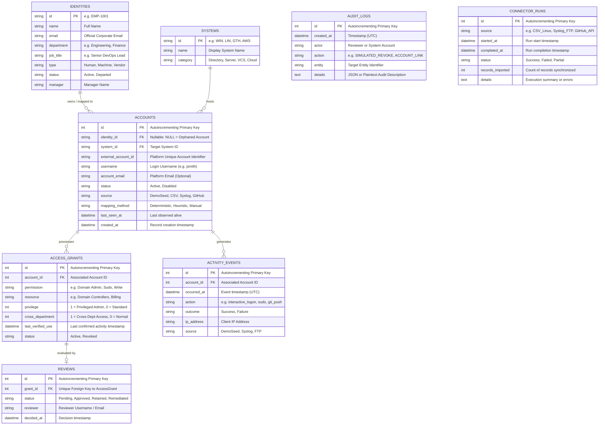

# Database Schema — AccessGuard Complete Research Lab

## 1. Database Architecture & Technology Stack

The AccessGuard database persistence layer is designed using enterprise relational modeling principles:

- **Database Engine:** PostgreSQL 17 (Official Alpine Docker distribution: `postgres:17-alpine`).
- **Container Port Mapping:** Host Port `5434` $\rightarrow$ Container Port `5432` (avoids conflicts with default local PostgreSQL instances).
- **ORM Layer:** SQLAlchemy 2.0 (Modern `Mapped` and `mapped_column` type-annotated declarations).
- **Migration Engine:** Alembic for automated schema versioning and deterministic rollbacks.
- **Connection Driver:** `psycopg` (v3 modern async/sync PostgreSQL adapter).
- **Database Name & User:** `accessguard_lab` / `accessguard_lab`.

---

## 2. Entity-Relationship Diagram (ERD)



---

## 3. Detailed Table Specifications

### 3.1. `identities`
Represents the canonical human or non-human workforce identity (sourced from HRIS or master directories).

```sql
CREATE TABLE identities (
    id VARCHAR(32) PRIMARY KEY,
    name VARCHAR(160) NOT NULL,
    email VARCHAR(255) NOT NULL,
    department VARCHAR(100) NOT NULL,
    job_title VARCHAR(120) NOT NULL,
    type VARCHAR(20) NOT NULL,
    status VARCHAR(20) NOT NULL,
    manager VARCHAR(120) NOT NULL,
    CONSTRAINT identity_type_valid CHECK (type IN ('Human', 'Machine', 'Vendor')),
    CONSTRAINT identity_status_valid CHECK (status IN ('Active', 'Departed'))
);
```

### 3.2. `systems`
Represents target connected platforms, infrastructure servers, or SaaS applications.

```sql
CREATE TABLE systems (
    id VARCHAR(32) PRIMARY KEY,
    name VARCHAR(120) NOT NULL,
    category VARCHAR(80) NOT NULL
);
```
*Standard System Codes:* `WIN` (Windows Active Directory), `LIN` (Production Linux Hosts), `GTH` (GitHub Enterprise), `AWS` (Cloud Infrastructure), `FIN` (ERP / Financial System).

### 3.3. `accounts`
Represents technical system accounts discovered across target systems. Can be mapped to a canonical identity or unlinked (orphaned).

```sql
CREATE TABLE accounts (
    id SERIAL PRIMARY KEY,
    identity_id VARCHAR(32) REFERENCES identities(id) ON DELETE SET NULL,
    system_id VARCHAR(32) NOT NULL REFERENCES systems(id),
    external_account_id VARCHAR(255) NOT NULL,
    username VARCHAR(255) NOT NULL,
    account_email VARCHAR(255) NULL,
    status VARCHAR(20) NOT NULL DEFAULT 'Active',
    source VARCHAR(30) NOT NULL DEFAULT 'DemoSeed',
    mapping_method VARCHAR(30) NULL,
    last_seen_at TIMESTAMPTZ NULL,
    created_at TIMESTAMPTZ NOT NULL DEFAULT CURRENT_TIMESTAMP,
    CONSTRAINT uq_account_system_external_id UNIQUE (system_id, external_account_id),
    CONSTRAINT account_status_valid CHECK (status IN ('Active', 'Disabled'))
);

CREATE INDEX ix_accounts_identity_id ON accounts (identity_id);
CREATE INDEX ix_accounts_system_id ON accounts (system_id);
```

### 3.4. `access_grants`
Represents individual privileges, roles, groups, or entitlements granted to an account on a resource.

```sql
CREATE TABLE access_grants (
    id SERIAL PRIMARY KEY,
    account_id INTEGER NOT NULL REFERENCES accounts(id),
    permission VARCHAR(80) NOT NULL,
    resource VARCHAR(255) NOT NULL,
    privilege INTEGER NOT NULL DEFAULT 0,
    cross_department INTEGER NOT NULL DEFAULT 0,
    last_verified_use TIMESTAMPTZ NULL,
    status VARCHAR(20) NOT NULL DEFAULT 'Active',
    CONSTRAINT grant_status_valid CHECK (status IN ('Active', 'Revoked'))
);

CREATE INDEX ix_access_grants_account_id ON access_grants (account_id);
```

### 3.5. `reviews`
Tracks governance certification campaigns, reviewer decisions, and remediation workflows.

```sql
CREATE TABLE reviews (
    id SERIAL PRIMARY KEY,
    grant_id INTEGER NOT NULL UNIQUE REFERENCES access_grants(id),
    status VARCHAR(20) NOT NULL DEFAULT 'Pending',
    reviewer VARCHAR(120) NULL,
    decided_at TIMESTAMPTZ NULL,
    CONSTRAINT review_status_valid CHECK (status IN ('Pending', 'Approved', 'Retained', 'Remediated'))
);
```

### 3.6. `activity_events`
Ingests telemetry and authentication logs. *Absence of events is explicitly treated as unverified, never as conclusive proof of non-use.*

```sql
CREATE TABLE activity_events (
    id SERIAL PRIMARY KEY,
    account_id INTEGER NOT NULL REFERENCES accounts(id),
    occurred_at TIMESTAMPTZ NOT NULL,
    action VARCHAR(70) NOT NULL,
    outcome VARCHAR(20) NOT NULL,
    ip_address VARCHAR(50) NULL,
    source VARCHAR(40) NOT NULL DEFAULT 'DemoSeed',
    CONSTRAINT activity_outcome_valid CHECK (outcome IN ('Success', 'Failure'))
);

CREATE INDEX ix_activity_events_account_id ON activity_events (account_id);
CREATE INDEX ix_activity_events_occurred_at ON activity_events (occurred_at);
```

### 3.7. `audit_logs`
An append-only historical compliance ledger recording all governance actions.

```sql
CREATE TABLE audit_logs (
    id SERIAL PRIMARY KEY,
    created_at TIMESTAMPTZ NOT NULL DEFAULT CURRENT_TIMESTAMP,
    actor VARCHAR(120) NOT NULL,
    action VARCHAR(80) NOT NULL,
    entity VARCHAR(180) NOT NULL,
    details TEXT NOT NULL
);
```

### 3.8. `connector_runs`
Tracks data ingestion batches, provenance, record volumes, and synchronization health.

```sql
CREATE TABLE connector_runs (
    id SERIAL PRIMARY KEY,
    source VARCHAR(60) NOT NULL,
    started_at TIMESTAMPTZ NOT NULL,
    completed_at TIMESTAMPTZ NULL,
    status VARCHAR(20) NOT NULL,
    records_imported INTEGER NOT NULL DEFAULT 0,
    details TEXT NOT NULL DEFAULT ''
);
```

---

## 4. State Transitions & Lifecycle Flows

### 4.1. Technical Account Mapping Lifecycle
```
[Unlinked / Orphaned]  ──(Admin links to Identity)──►  [Linked (Manual)]
         ▲                                                     │
         └─────────────(Admin unlinks Account)─────────────────┘
```

### 4.2. Access Review Certification Lifecycle
```
[Campaign Generated]
        │
        ▼
   [Pending] ───────────────► [Retained] (Certified as legitimate)
        │
        ▼
   [Approved] (Marked for removal)
        │
        ▼
   [Simulated Revoke Triggered]
        │
        ▼
   [Remediated] (AccessGrant status transitions to 'Revoked')
```

### 4.3. Employee Lifecycle Impact on Entitlements
```
[Identity: Active] ──(Employee Leaves)──► [Identity: Departed]
                                                   │
                                                   ▼
                                      [Offboarding Alert Fired]
                                                   │
                                                   ▼
                                      [Batch Review Generated]
                                                   │
                                                   ▼
                                      [Simulated Remediation]
```

---

## 5. Cross-Subsystem Schema Links

In addition to the core PostgreSQL database, AccessGuard correlates with the **Dialog Access Log Subsystem** (`accesslog-main/`), which stores:
- `devices`: Discovered network endpoints (`ip`, `hostname`, `mac_address`, `os_name`, `first_seen`, `last_seen`).
- `logs`: Raw ingested syslog events (`raw_message`, `facility`, `severity`, `parsed_timestamp`, `client_ip`).
- `alerts`: Ingestion security alerts (`alert_type`, `message`, `source_ip`, `created_at`).

These logs are correlated with the core database via normalized `username` matching against `accounts.username`.
