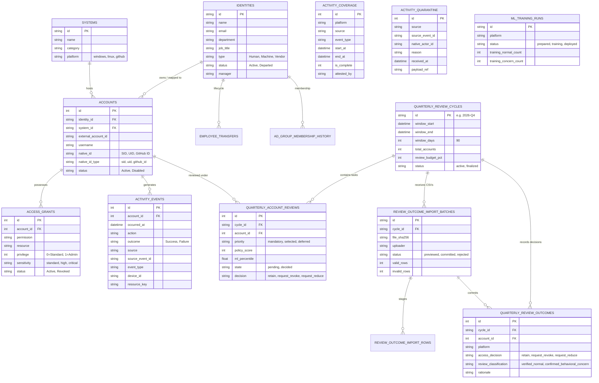

# Database Schema — AccessGuard Complete Research Lab

## 1. Database Architecture & Technology Stack

The AccessGuard database persistence layer is designed using enterprise relational modeling principles:

- **Database Engine:** PostgreSQL 17 (Official Alpine Docker distribution: `postgres:17-alpine`).
- **Container Port Mapping:** Host Port `5434` $\rightarrow$ Container Port `5432` (avoids conflicts with default local PostgreSQL instances).
- **ORM Layer:** SQLAlchemy 2.0 (`Mapped` and `mapped_column` type-annotated declarations).
- **Migration Engine:** Alembic for automated schema versioning and deterministic rollbacks (`backend/alembic/versions/`).
- **Connection Driver:** `psycopg` (v3 modern PostgreSQL adapter).
- **Database Name & User:** `accessguard_lab` / `accessguard_lab`.

---

## 2. Complete Entity-Relationship Diagram (V10)

---

## 3. Core Tables Specification

### 3.1. `identities`
Canonical enterprise directory containing human employees, contractors, and service identities.
- `id` (PK): Unique identity code (`EMP-001`, `VND-2001`).
- `type`: Check constraint `type IN ('Human','Machine','Vendor')`.
- `status`: Check constraint `status IN ('Active','Departed')`.
- `manager`: Name or code of the direct supervisor.

### 3.2. `systems`
Managed IT assets, directories, and cloud services.
- `id` (PK): System identifier (`AD`, `LIN`, `GH`).
- `platform`: Controlled platform key (`windows`, `linux`, `github`, or `null`).

### 3.3. `accounts`
Technical accounts residing on connected target systems.
- `id` (PK): Integer autoincrement primary key.
- `identity_id` (FK): Nullable; accounts without an identity are unlinked/orphaned.
- `native_id`: Hardware or directory-native identifier (Windows SID, Linux UID, GitHub numeric ID).
- `native_id_type`: Identifier format (`sid`, `uid`, `github_id`).

### 3.4. `access_grants`
Entitlements and permission assignments held by technical accounts.
- `privilege`: `1` for administrative/root access, `0` for standard user rights.
- `sensitivity`: Criticality tier (`standard`, `high`, `critical`).

### 3.5. `activity_events`
Normalized activity log evidence.
- `occurred_at`: Event timestamp in UTC.
- `source_event_id`: External event identifier for deduplication.
- `event_type`: Categorical telemetry type (`logon`, `resource_use`, `admin_action`).

---

## 4. V10 Quarterly ML & Governance Tables

### 4.1. `activity_coverage`
Explicit coverage attestations for platform event types.
- `is_complete`: `1` if connector logs are complete across the entire interval without gaps.
- `attested_by`: Security operations officer or auditor responsible for the telemetry guarantee.

### 4.2. `activity_quarantine`
Isolates events that failed deterministic resolution.
- `reason`: Failure classification (`no_matching_account`, `ambiguous_account_match`, `missing_user_identifier`).
- `payload_ref`: Raw event payload preserved for manual investigation.

### 4.3. `employee_transfers`
HR department transfer history. Used to enforce mandatory review obligations for role changers.
- `effective_at`: Date the transfer took effect.
- `from_department` / `to_department`: Department transition details.

### 4.4. `ad_group_catalog` & `ad_group_membership_history`
Active Directory group governance:
- `is_privileged`: Flag for Tier 0/1 administrative groups (e.g. Domain Admins).
- `in_scope`: Whether the group is governed under current access review policies.

### 4.5. `quarterly_review_cycles`
Frozen 90-day review cycles.
- `cycle_id`: Identifier (e.g. `2026-Q4`).
- `window_start` / `window_end`: Exact 90-day review boundaries.
- `review_budget_pct`: Target review queue percentage (default 10-20%).

### 4.6. `quarterly_account_reviews`
Account-level tasks generated for an active cycle.
- `priority`: `mandatory`, `selected`, `deferred_candidate`, or `insufficient_evidence`.
- `policy_score`: Explainable rule score (0-100).
- `ml_percentile`: Advisory anomaly percentile from Aegis V9.
- `state`: Task lifecycle (`pending`, `in_review`, `decided`, `closed`).
- `decision`: Human review action (`retain`, `request_revoke`, `request_reduce`, `defer`, `escalate`).

### 4.7. `review_outcome_import_batches` & `review_outcome_import_rows`
CSV upload staging and validation records.
- `file_sha256`: Hash of the uploaded file for audit provenance.
- `valid_rows` / `invalid_rows` / `duplicate_rows`: Validation metrics.
- Rows are committed atomically to `quarterly_review_outcomes` only when zero errors remain.

### 4.8. `quarterly_review_outcomes`
Final committed governance outcomes per `(cycle_id, account_id)`.
- `access_decision`: Retain, request_revoke, or request_reduce.
- `review_classification`: Verified behavioral classification (`verified_normal`, `confirmed_behavioral_concern`, `confirmed_policy_concern`, `insufficient_evidence`).
- `rationale`: Reviewer justification.

### 4.9. `ml_training_runs`
Records frozen dataset snapshots prepared for offline training.
- `training_normal_count`: Baseline normal examples (`label=0`).
- `training_concern_count`: Holdout concern examples (`label=1`).
