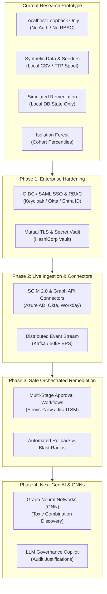

# Future Implementations & Production Roadmap — AccessGuard

## 1. Overview & Transition Strategy

AccessGuard is currently a high-fidelity **research and demonstration laboratory**. To transition the platform into an enterprise-grade, production-ready **AI-assisted Identity Governance and Administration (IGA)** suite, a comprehensive engineering roadmap is outlined below.

The roadmap addresses enterprise security controls, live system connectors, automated remediation orchestration, advanced deep learning models, enterprise scalability, and regulatory compliance.

---

## 2. Pillar 1: Enterprise Security Hardening & Zero Trust

### 2.1. Enterprise Identity Provider (IdP) & SSO Integration
- **Implementation:** Implement standard OpenID Connect (OIDC) and SAML 2.0 authentication supporting Okta, Microsoft Entra ID, PingFederate, and Keycloak.
- **Session Management:** Secure HTTP-only JWTs with short expiry (15 minutes), refresh token rotation, and redis-backed session revocation.

### 2.2. Granular Role-Based Access Control (RBAC)
- Replace open local endpoints with strict backend-enforced RBAC:
  - `SuperAdmin`: System configuration, database operations, connector management.
  - `IAM_Reviewer`: View review queues, inspect evidence, certify ("Retain") or flag ("Approve Removal").
  - `Security_Approver`: Secondary signature authority required for high-risk/admin revocations.
  - `Auditor`: Read-only access to audit logs, compliance reports, and model metrics.
  - `End_User`: Self-service view of own assigned accounts and access request submissions.

### 2.3. Transport Security & Secrets Management
- Enforce strict TLS 1.3 across all client-to-backend and service-to-service communication.
- Implement mutual TLS (mTLS) for microservice communication between AccessGuard Backend (`:8000`), Dialog ML (`:8001`), and Syslog Collectors (`:8002`).
- Eliminate `.env` plaintext files in favor of **HashiCorp Vault** or **AWS Secrets Manager** with automated credential rotation.

---

## 3. Pillar 2: Live Enterprise Connectors & Data Ingestion

### 3.1. Standardized SCIM 2.0 Client & Server
- Implement RFC 7643 / RFC 7644 (SCIM 2.0) protocol support to automatically synchronize users and groups from HRIS platforms (Workday, BambooHR, SAP SuccessFactors).

### 3.2. Production Target Connectors
- **Microsoft Entra ID / Active Directory:** Graph API and LDAP connectors with delta synchronization, tracking nested group memberships and organizational units (OUs).
- **Cloud Infrastructure (AWS IAM, GCP IAM, Azure RBAC):** Ingestion of roles, policies, service principals, cross-account trust relationships, and IAM Access Analyzer findings.
- **Enterprise SaaS:** Connectors for Salesforce, ServiceNow, Snowflake, and Google Workspace.
- **Linux / UNIX Infrastructure:** SSSD / FreeIPA / Kerberos directory connector with automated `/etc/sudoers` parsing.

### 3.3. Connector Reliability, Health SLAs & Rate Limiting
- Implement robust exponential backoff, rate limit throttling, pagination cursors, and circuit breakers for external API calls.
- Track freshness SLAs: alert when any connected system fails to synchronize within 24 hours.

---

## 4. Pillar 3: Safe Orchestrated Remediation Engine

### 4.1. From Simulation to Safe Real-World Remediation
- Transition from local database state updates (`Revoked (Simulated)`) to safe, audited, target-system provisioning:
  - **Stage 1 (Dry-Run / Pre-Check):** Calculate blast radius. Check whether revoking this permission will break active dependent workloads or automated service accounts.
  - **Stage 2 (Dual Custody Approval):** For critical roles (Domain Admin, AWS Root), require approvals from both the identity's manager and the resource owner.
  - **Stage 3 (Target System Execution):** Execute remote revocation via secure connector (e.g., remove user from AD Security Group or deactivate API key).
  - **Stage 4 (Post-Change Verification):** Query target system to verify successful removal.
  - **Stage 5 (Automated Compensation / Rollback):** If verification fails or breaks business continuity, execute an automated rollback transaction within a 48-hour recovery window.

### 4.2. ITSM Ticket Integration
- Bidirectional synchronization with **ServiceNow** (Change Management / Service Catalog) and **Jira Service Management**:
  - Automatically create Change Requests when a revocation batch is initiated.
  - Await ITSM approval before triggering target system mutation.
  - Automatically resolve tickets with attached audit certificates upon completion.

---

## 5. Pillar 4: Advanced Artificial Intelligence & Graph Analytics

### 5.1. Graph Neural Networks (GNNs) for Identity-Entitlement Graphs
- Model organizational identities, accounts, entitlements, and resources as a heterogeneous graph:
  $$\mathcal{G} = (\mathcal{V}_{\text{Identity}} \cup \mathcal{V}_{\text{Account}} \cup \mathcal{V}_{\text{Entitlement}} \cup \mathcal{V}_{\text{Resource}}, \mathcal{E})$$
- Train Graph Convolutional Networks (GCN) or Relational Graph Attention Networks (RGAT) to:
  - Detect community clusters and natural peer groups automatically without relying on static department fields.
  - Identify toxic entitlement paths and Separation of Duties (SoD) cycles across multi-tier application architectures.

### 5.2. Calibrated Probabilistic Modeling
- Transition from relative cohort anomaly percentiles to **calibrated Bayesian posterior probabilities**:
  $$P(\text{Excessive Access} \mid \text{Activity Patterns, Peer Norms, Lifecycle Status})$$
- Enable setting absolute, organization-wide risk tolerances (e.g., *"Flag all grants with $>85\%$ probability of being superfluous"*).

### 5.3. Generative AI & LLM Governance Copilot
- Deploy an enterprise LLM copilot (fine-tuned on compliance standards and IAM policies) to:
  - Generate plain-English justification summaries for complex permissions.
  - Provide conversational query support: *"Which contractors in DevOps have access to customer PII in Snowflake without active logins for 60 days?"*
  - Automatically draft SOC 2 audit responses and risk mitigation statements.

---

## 6. Pillar 5: Scalability & Enterprise Infrastructure

### 6.1. Distributed Worker Architecture
- Decouple long-running tasks (log ingestion, connector syncing, ML quarterly retraining) from the FastAPI web server using **Celery** or **Temporal.io** with Redis / RabbitMQ brokers.

### 6.2. High-Throughput Event Streaming
- Deploy **Apache Kafka** or **Redpanda** as the ingestion backbone for the Syslog Subsystem, supporting 50,000+ Events Per Second (EPS) from distributed global endpoints.

### 6.3. Database Scaling & Partitioning
- Implement PostgreSQL table partitioning by time on `activity_events` (monthly or weekly partitions) and `audit_logs`.
- Configure read-replicas for analytical queries and reporting engines, reserving the primary database for transaction-critical governance actions.

---

## 7. Pillar 6: Regulatory Compliance & Audit Assurance

### 7.1. Built-In Compliance Framework Mappings
Provide automated mapping matrices and one-click certification reports for:
- **SOC 2 Type II:** Trust Services Criteria CC6.1 (Logical Access), CC6.2 (User Registration & Access), CC6.3 (Access Modification & Revocation).
- **ISO/IEC 27001:2022:** Control A.9.2 (User Access Management), Control A.9.4 (Privileged Access Rights).
- **Sarbanes-Oxley (SOX) Section 404:** User Access Reviews for Financial Systems (e.g., SAP, Oracle ERP).
- **HIPAA Security Rule:** Technical Safeguards § 164.312(a)(1) (Access Control & Emergency Access).
- **PCI-DSS v4.0:** Requirement 7 (Restrict access to system components) & Requirement 8 (Identify users and authenticate access).

### 7.2. Cryptographically Verifiable Audit Ledger
- Implement a tamper-evident audit ledger using **Merkle Trees** or Write-Once-Read-Many (WORM) storage.
- Ensure every audit log entry is digitally signed with the reviewer's private key and anchored with RFC 3161 timestamps, preventing retrospective log modification.
