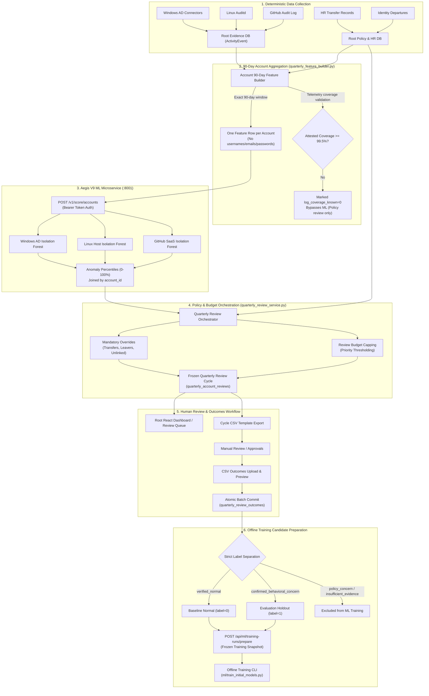

# Machine Learning Implementation — AccessGuard Quarterly ML Integration V10

## 1. Machine Learning Vision & Strategy

AccessGuard applies Machine Learning to **Identity Governance & Administration (IGA)** with an uncompromising commitment to **Explainable AI (XAI)**, **Human-in-the-Loop decision authority**, and **strict privacy/security guardrails**.

In enterprise environments, quarterly access reviews suffer from severe **"Reviewer Fatigue"**: line managers face hundreds of repetitive entitlements and default to rubber-stamping (*"Approve All"*), leaving orphaned accounts and privilege creep undetected.

AccessGuard solves this by deploying **calibrated, platform-specific Unsupervised Anomaly Detection** (Isolation Forests with peer-group reference distributions) to prioritize the review queue. The ML engine highlights accounts whose 90-day behavioral telemetry and entitlement profiles diverge sharply from peers, allowing reviewers to focus on high-risk outliers within an allocated review budget.



---

## 2. Aegis V9/V10 Platform Model Architecture

The quarterly ML engine runs as an isolated microservice (`ml/backend`) exposing FastAPI on port `8001`. It replaces the legacy grant-level demo with **three independent, platform-specific Isolation Forest models**:

| Platform | Model Key | Telemetry Sources | Signal Feeds | Distinct Features |
|---|---|---|---|---|
| **Windows Active Directory** | `windows` | WinEvent 4624/4625/4672, Kerberos, AD DS | Privileged logon events, AD group memberships | `ad_group_count`, `mapped_access_ad_group_count`, `ad_department_mismatch`, `windows_privileged_logon_events` |
| **Linux Infrastructure** | `linux` | `auditd`, PAM, SSH, syslog | Sudo executions, elevated sessions | `linux_sudo_events`, `linux_sudo_coverage_known`, `privileged_ad_group_count` |
| **GitHub SaaS** | `github` | GitHub Audit Log, REST/GraphQL | Repo pull/push, role assignments | `github_repo_activity_events`, `github_repo_activity_coverage_known` |

### Guardrails:
1. **Zero Cross-Platform Fallback:** GitLab is never scored with the GitHub model; unknown platforms return `unscored` with `unsupported_platform:no_cross_platform_fallback`.
2. **Strict 90-Day Calibration:** Models are calibrated strictly for 90-day review windows. Requests with mismatched windows return `unscored`.
3. **No In-Batch Fitting:** The inference endpoint (`POST /v1/score/accounts`) **never fits or adjusts an Isolation Forest**. All scoring is read-only against pre-trained, SHA-256 verified artifacts.
4. **Token Authentication:** Requests require `Authorization: Bearer <ML_SERVICE_TOKEN>` with key length $\ge 32$ characters.

---

## 3. Account-Level Feature Engineering (`backend/quarterly_feature_builder.py`)

Feature extraction aggregates one row per technical account over the exact 90-day UTC window $[\text{cycle\_start}, \text{cycle\_end}]$.

### 3.1. Strict Privacy & Feature Hygiene
The feature dictionary sent over HTTP to the ML service strictly excludes identity identifiers:
- ❌ **Forbidden in features:** `username`, `email`, `employee_name`, `manager`, `ip_address`, `password`, `token`, `group_id`, `label`, `review_outcome`.
- ✅ **Permitted:** `account_id` is transmitted only as an opaque correlation key outside the feature dictionary.

### 3.2. Common Governance Features
Shared across all three platform models:
- **Entitlements:** `entitlement_count`, `privileged_entitlements`, `sensitive_entitlements`.
- **Logins:** `successful_logins_window`, `failed_logins_window`, `active_days_window`.
- **Resource Usage:** `resource_use_events_window`, `distinct_resources_used_window`, `resource_uses_month_1`, `resource_uses_month_2`, `resource_uses_month_3`, `use_age_days`, `use_evidence_observed`.
  - *Rule:* Generic authentication/login events do **NOT** count as resource usage. Only explicit business resource interactions (file reads, API calls, repo commits) increment `resource_use_events_window`.
- **Telemetry Coverage:** `log_coverage_days`, `log_coverage_known`.
  - *Rule:* Coverage must be explicitly attested via `activity_coverage` table. If coverage is missing or $< 99.5\%$, `log_coverage_known=0`. Inactivity during unmonitored windows is never treated as normal zero usage.
- **Organizational Dynamics:** `group_changes_window`, `transfers_window`, `recent_transfer_flag`, `out_of_scope_ad_group_count`.

---

## 4. Policy Orchestration & Review Budgeting (`backend/quarterly_review_service.py`)

The root backend combines ML advisory percentiles with deterministic governance rules:

### 4.1. Mandatory Review Overrides
The following conditions immediately mandate human review, bypassing any budget cap:
1. **Departed Employee Access:** Owner identity is marked `Departed` but account remains `Active` (+50 policy score).
2. **Unlinked Technical Account:** Account has no mapped owner identity (+40 policy score).
3. **Internal HR Transfer:** Employee transferred departments within the review window (+35 policy score).
4. **Out-of-Scope AD Groups:** Account holds groups flagged as out-of-scope by `ad_group_catalog` (+30 policy score).

### 4.2. Review Budget Capping
- **Budget Target:** Calculated as $\max(1, \text{total\_accounts} \times \text{budget\_pct} / 100)$.
- **Selection Rule:** Candidates outside mandatory overrides must satisfy $\text{policy\_score} \ge 30$ or $\text{ml\_percentile} \ge 80.0$ to enter the queue.
- **Spare Budget Preservation:** Unused budget is **never** filled with low-risk accounts. Low-risk accounts remain in `deferred_candidate` status.

---

## 5. Reviewed Outcomes CSV Workflow

Authorized reviewers can conduct reviews via the UI or export/upload a standardized CSV batch:

### 5.1. CSV Header Specification (V10)
```csv
schema_version,review_cycle_id,account_id,platform,reviewer_id,reviewed_at_utc,review_classification,access_decision,rationale,evidence_reference
```

### 5.2. Validation Engine
The backend performs row-by-row staging in `review_outcome_import_rows`:
- **BOM Tolerance:** UTF-8 BOM (`\ufeff`) is parsed transparently.
- **Schema & Cycle Check:** `schema_version == 1` and `review_cycle_id == active_cycle_id`.
- **Account Existence:** `account_id` must match a recognized technical account in `accounts`.
- **Duplicate Prevention:** Rejects duplicate accounts within the file or accounts already committed in the cycle.
- **Decision Validation:** `access_decision` must be one of `retain`, `request_revoke`, `request_reduce`, `defer`, `escalate`.
- **Classification Validation:** `review_classification` must be one of `verified_normal`, `confirmed_behavioral_concern`, `confirmed_policy_concern`, `insufficient_evidence`, `not_applicable`.
- **Mandatory Rationale:** `request_revoke` and `request_reduce` require non-empty `rationale`.

### 5.3. Atomic Commit Guarantee
The commit endpoint (`commit_outcome_batch`) operates as an all-or-nothing transaction. If `invalid_rows > 0` or `duplicate_rows > 0`, the batch cannot be committed and zero rows are written to `quarterly_review_outcomes`.

---

## 6. Strict Human Review Label Separation

ML models must **never** conflate administrative decisions with behavioral truth:

$$\text{access\_decision} \neq \text{review\_classification}$$

- **Scenario 1:** A reviewer retains access for an engineer because of an urgent production incident, but notes their activity was highly anomalous.
  - `access_decision = retain`
  - `review_classification = confirmed_behavioral_concern`
  - **ML Impact:** The account is flagged as an anomaly holdout (`label=1`), **never** included in baseline normal (`label=0`).
- **Scenario 2:** An account has zero activity due to parental leave and is retained.
  - `access_decision = retain`
  - `review_classification = confirmed_policy_concern`
  - **ML Impact:** Excluded from training baseline to prevent polluting normal behavioral profiles.

### Training Data Filtering Rules:
- **Baseline Normal (`label=0`):** Only accounts with `review_classification = 'verified_normal'` and verified activity.
- **Evaluation Holdout (`label=1`):** Only accounts with `review_classification = 'confirmed_behavioral_concern'`.
- **Excluded:** Policy concerns, leavers, transfers, and insufficient evidence cases are discarded from model retraining.

---

## 7. Offline Model Training & Artifact Verification

Model training is conducted offline using the CLI script `ml/train_initial_models.py` or `platform_train.py`.

```powershell
# Train and persist initial 3 platform models with integrity digests
& python ml/train_initial_models.py
```

### Artifact Manifest (`ml/backend/ml_artifacts/platforms/{platform}.json`):
```json
{
  "platform": "windows",
  "schema": "aegis-v8-quarterly-platform-specific-1",
  "algorithm": "IsolationForest",
  "trees": 160,
  "seed": 42,
  "normal_training_records": 170,
  "evaluation": {
    "holdout_count": 50,
    "holdout_positive": 7,
    "roc_auc": 1.0,
    "average_precision": 1.0
  },
  "sha256": "4b5c...e23f"
}
```

The ML microservice validates the SHA-256 hash on startup; tampered or unverified artifacts are refused.
