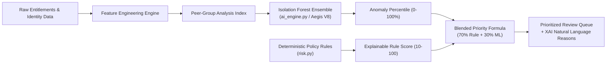
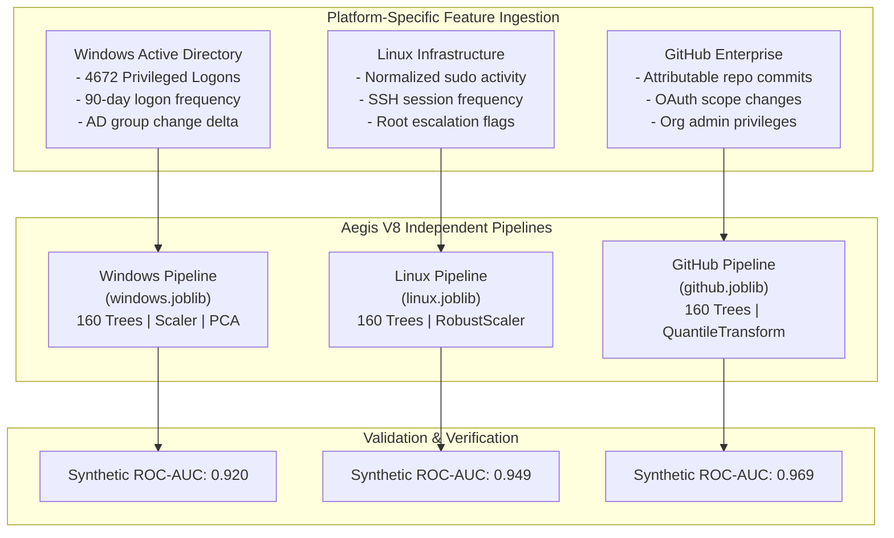

# Machine Learning Implementation — AccessGuard Complete Research Lab

## 1. Machine Learning Vision & Strategy

AccessGuard applies Machine Learning to **Identity Governance & Administration (IGA)** with an emphasis on **Explainable AI (XAI)** and **Human-in-the-Loop decision support**.

In large organizations, manual access certification campaigns suffer from severe **"Reviewer Fatigue"**: managers are presented with hundreds of identical permissions and routinely click *"Approve All"* without inspecting security risks. 

AccessGuard addresses this by using **Unsupervised Anomaly Detection** (specifically, **Isolation Forests** combined with **Peer-Group Analysis**) to rank and prioritize the review queue. The model highlights access combinations that diverge sharply from an employee's organizational peers, without replacing human authorization.



---

## 2. Dual-Tier ML Architecture

AccessGuard provides two complementary tiers of ML inference:

| Dimension | Tier 1: Local In-Process Engine (`backend/ai_engine.py`) | Tier 2: Dialog Final ML Microservice (`ml/` & `backend/mock_ml_service.py`) |
|---|---|---|
| **Location** | Embedded in FastAPI backend process | Independent microservice on port `8001` |
| **Model Scope** | Global Cohort Isolation Forest | **Aegis V8: Three Independent Platform Pipelines** (Windows, Linux, GitHub) |
| **Training Frequency** | Fits dynamically on the current active cohort | Quarterly batch training on historical telemetry with held-out validation |
| **Artifact Storage** | In-memory transient model | Serialized Joblib files (`.joblib`) with SHA-256 integrity manifests |
| **Failover Behavior** | Always-available fallback if microservice is offline | Primary high-fidelity engine when connected |

---

## 3. Tier 1: Local Cohort Isolation Forest (`backend/ai_engine.py`)

### 3.1. 8-Dimensional Feature Vector
For every active access grant, `ai_engine.py` constructs a numeric vector across 8 features:

```python
FEATURES = [
    'privileged',               # 1.0 if Admin/Root permission, else 0.0
    'cross_department',         # 1.0 if grant crosses department boundaries, else 0.0
    'departed_owner',           # 1.0 if owner status is 'Departed', else 0.0
    'unlinked_owner',           # 1.0 if account has no linked identity, else 0.0
    'days_since_verified_use',  # Normalised continuous value: min(365, age_in_days) / 365.0
    'use_evidence_missing',     # 1.0 if no activity logs exist at all, else 0.0
    'role_rarity',              # 1.0 / count of same (department, system, permission) triples
    'peer_privilege_gap',       # 1.0 if user has Admin but <25% of peers in dept have Admin
]
```

### 3.2. Peer-Group Indexing
The peer index calculates baseline privilege distribution per department:

$$\text{Admin Fraction}(\text{Dept}) = \frac{\sum \text{Admin Grants in Dept}}{\max(1, \sum \text{Total Grants in Dept})}$$

$$\text{Peer Privilege Gap} = \begin{cases} 1.0 & \text{if } \text{is\_admin} = 1 \text{ and } \text{Admin Fraction}(\text{Dept}) < 0.25 \\ 0.0 & \text{otherwise} \end{cases}$$

### 3.3. Isolation Forest Mathematical Formulation
- **Algorithm:** Scikit-Learn `IsolationForest`.
- **Ensemble Parameters:**
  - `n_estimators = 150` trees.
  - `max_samples = 'auto'`.
  - `random_state = 42`.
  - `contamination`: Dynamically bounded between `0.05` and `0.15` based on high-risk rule proportion:
    $$\text{contamination} = \min\left(0.15, \max\left(0.05, \frac{|\{r \in \text{Cohort} : \text{RuleScore}(r) \ge 60\}|}{|\text{Cohort}|}\right)\right)$$
- **Score Inversion & Percentile Ranking:**
  1. Raw anomaly scores are extracted via negative decision function:
     $$\text{raw\_score}_i = -\text{model.decision\_function}(X_i)$$
  2. Scores are converted to uniform cohort percentile ranks:
     $$\text{Percentile}_i = \text{round}\left(100 \times \frac{\text{Rank}(\text{raw\_score}_i)}{N - 1}\right)$$

### 3.4. Blended Priority Formula
The final review queue priority combines the explainable rule score with the ML anomaly percentile:

$$\text{Combined Priority} = \text{round}\left(0.70 \times \text{Rule Score} + 0.30 \times \text{Anomaly Percentile}\right)$$

### 3.5. Recommendation Thresholds
- **Escalate for Urgent Review:** Combined Priority $\ge 75$ OR Rule Score $\ge 85$.
- **Request Human Review:** Combined Priority $\ge 60$ OR Rule Score $\ge 60$.
- **Monitor:** Combined Priority $< 60$ AND Rule Score $< 60$.

---

## 4. Tier 2: Dialog Final ML — Aegis V8 Three-Platform Architecture

In the advanced microservice (`ml/backend/app/ml/platform_models.py`), the single monolithic model is replaced by **three independent platform-specific pipelines**:



### 4.1. Platform Specifications

#### 1. Windows Active Directory Model (`windows.joblib`)
- **Key Features:** 90-day interactive logon frequency, Event ID 4672 privileged logon counts, AD security group count, organizational unit (OU) transfer delta, department mismatch flags.
- **Artifact:** `ml/backend/ml_artifacts/platforms/windows.joblib` (and `.json` metadata).

#### 2. Linux PAM / Server Model (`linux.joblib`)
- **Key Features:** Audited `sudo` command executions, PAM authentication sessions, shell access levels, service account usage flags, group transfer recency.
- **Artifact:** `ml/backend/ml_artifacts/platforms/linux.joblib` (and `.json` metadata).

#### 3. GitHub Enterprise Model (`github.joblib`)
- **Key Features:** Repository commit authorship, team admin entitlements, OAuth app authorizations, public/private repository scope access, organization owner status.
- **Artifact:** `ml/backend/ml_artifacts/platforms/github.joblib` (and `.json` metadata).

---

## 5. Training, Evaluation & Group-Based Splitting

To prevent data leakage during research evaluation:
1. **Group-Based Splitting:** Data is partitioned by `account_group` (75% training / 25% holdout). Splitting randomly across rows is strictly prohibited, as multiple entitlements belonging to the same employee would contaminate test sets.
2. **Semi-Supervised Normalcy Fitting:** Models are fitted exclusively on known-normal, baseline access records.
3. **Artifact Integrity:** Each trained artifact generates a companion `.json` manifest storing:
   - SHA-256 file hash.
   - Training UTC timestamp.
   - Exact input feature list.
   - Held-out ROC-AUC and Average Precision (PR-AUC).
   - HMAC signing key support (`AEGIS_MODEL_SIGNING_KEY`).

---

## 6. Explainable AI (XAI) & Ethical Guardrails

AccessGuard enforces strict ethical and algorithmic boundaries:

1. **Anomaly $\ne$ Malice:** Statistical anomaly indicates novelty relative to the cohort; it does not constitute proof of unauthorized behavior or policy violation.
2. **Deterministic Primacy:** Machine learning never overrules explicit security policies (e.g., departed employees or unlinked accounts retain high risk regardless of ML output).
3. **Strict Human-in-the-Loop:** Anomaly scores are strictly advisory prioritizations. Automated revocation by the ML engine is architecturally blocked.
4. **Epistemic Humility:** When activity telemetry is missing, the system outputs:
   > *"Use evidence unavailable — absence of logs does NOT prove access is unused."*
   The ML engine is barred from treating an unmonitored server as a dormant account.
