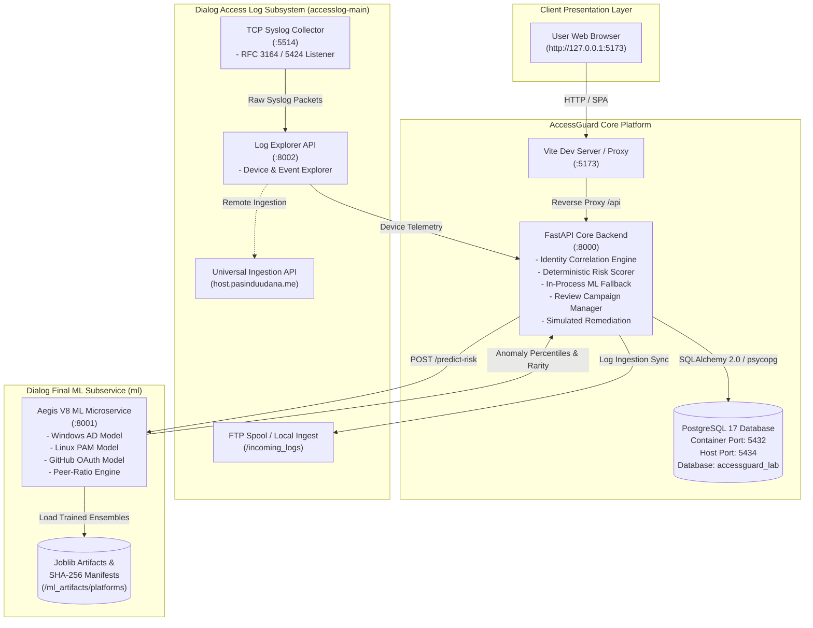
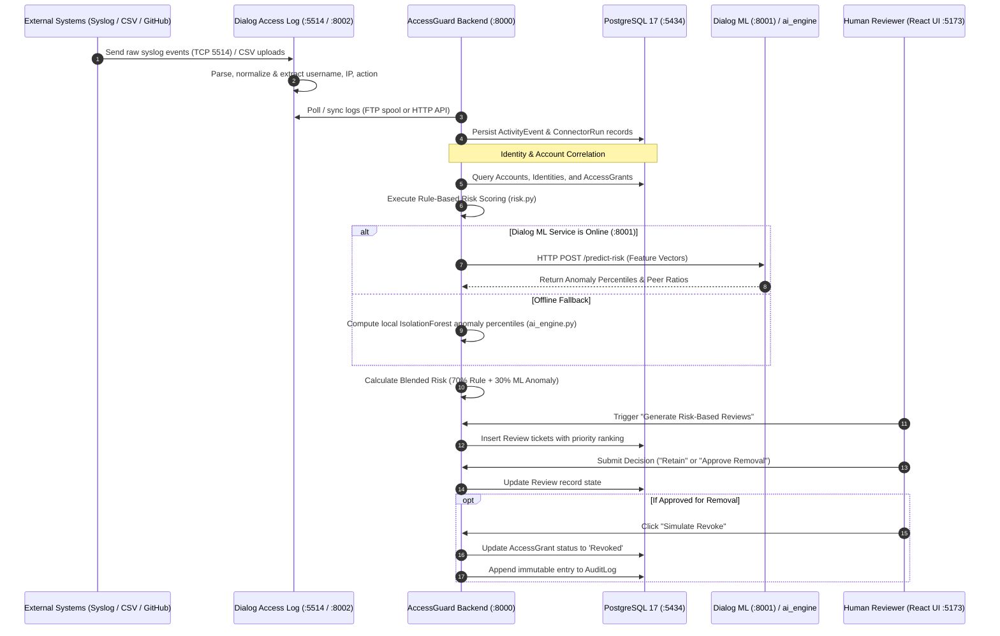

# Project Architecture — AccessGuard Complete Research Lab

## 1. System Vision & Paradigm

**AccessGuard** is an open, local-first research platform engineered for **AI-assisted Identity Governance and Administration (IGA)**. 

In enterprise environments, organizations face **"Access Creep"** (privilege accumulation as employees switch roles or projects), orphaned accounts (active credentials belonging to departed contractors or forgotten services), toxic entitlement combinations (Separation of Duties conflicts), and unmonitored administrative sprawl. 

Traditional IGA systems either rely on rigid static role definitions that become outdated instantly, or black-box algorithmic certifiers that risk business interruption. AccessGuard explores a third approach: **transparent hybrid governance**, combining deterministic explainable policy rules with unsupervised Isolation Forest anomaly scoring to prioritize human reviewer queues under strict safety constraints.

---

## 2. High-Level Ecosystem Topology

The AccessGuard ecosystem unifies three specialized micro-components into an end-to-end access governance workflow:

---

## 3. Subsystem Breakdown

### 3.1. AccessGuard Core Backend (`backend/`)
- **Framework & Runtime:** Python 3.11+, FastAPI, Uvicorn ASGI.
- **Data Persistence:** SQLAlchemy 2.0 (declarative ORM), Alembic migrations, PostgreSQL 17 (accessed at `127.0.0.1:5434`).
- **Core Engine Modules:**
  - `main.py`: REST API router, CORS configuration, request orchestration, and reporting endpoints.
  - `models.py`: Relational database schema mapping canonical identities, accounts, access grants, reviews, audit logs, and activity events.
  - `risk.py`: Deterministic, explainable rule-based risk scoring engine.
  - `ai_engine.py`: In-process Scikit-Learn Isolation Forest fallback engine for local anomaly ranking.
  - `accesslog_client.py`: HTTP adapter communicating with Dialog Access Log (`:8002`) and Pasindu's Sentinel cloud API.
  - `ml_client.py`: Client adapter for Hashan's Dialog Final ML microservice (`:8001`).
  - `connectors/`: Safe data ingestion adapters (CSV importer, read-only GitHub REST connector, local FTP spool synchronizer).
  - `seed_demo.py`: Idempotent seed script injecting comprehensive synthetic enterprise identity hierarchies and activity logs.

### 3.2. AccessGuard Core Frontend (`frontend/`)
- **Framework & Tooling:** React 19, Vite, Tailwind CSS v4, Lucide React icons, Recharts data visualization.
- **Design Language:** Dark-mode cyber-security operations center (SOC) UI with real-time responsive data tables, modal dialogs, and statistical widgets.
- **Governance Tabs (14 Views):**
  1. *Executive Overview Dashboard*: Enterprise risk KPIs, department risk distributions, and review campaign velocity.
  2. *Identity Directory*: Canonical employee registry linking human, machine, and vendor identities across HR and IT.
  3. *Live Devices & Logs*: Ingested devices and real-time normalized syslog feeds from Linux, Windows, and firewall hosts.
  4. *Account Mapping*: Cross-system account correlation, orphaned service account identification, and manual linking/unlinking workflows.
  5. *Access Inventory*: Granular entitlement catalog with resource tags, permission scopes, and privilege levels.
  6. *AI Risk Analysis*: Dual-view comparative scoring (Explainable Heuristics vs. ML Isolation Forest Percentiles).
  7. *Access Reviews*: Review campaign manager supporting human certification ("Retain") and revocation ("Approve Removal").
  8. *Risk Alerts*: High-priority security warnings (toxic combinations, dormant admin accounts, unlinked technical access).
  9. *Activity Evidence*: Correlated authentication events, login outcomes (Success/Failure), and UTC timestamp traces.
  10. *Offboarding Center*: Governance center tracking departed employees retaining lingering credentials with batch remediation.
  11. *Integrations Hub*: Status diagnostics for Dialog Syslog (:8002), Dialog ML (:8001), Sentinel API, and FTP sync.
  12. *Audit Reports*: Immutable, chronological event ledger capturing all governance decisions.
  13. *Research Reports*: Exportable academic metrics, PR-AUC evaluations, and connector provenance summaries.
  14. *Settings*: Database reset, demo re-seeding, and connection string configurations.

### 3.3. Dialog Access Log Subsystem (`accesslog-main/`)
- **Service Lead:** Pasindu Udana
- **Components:**
  - `collector/collector.py`: Async TCP daemon bound to port `5514` ingesting RFC 3164/5424 syslog messages.
  - `api/app.py` & `standalone_api.py`: FastAPI server on port `8002` exposing `/api/devices`, `/api/events`, and `/api/alerts`.
  - Normalizes raw Linux auth.log, Windows Security Event Logs (e.g., Event IDs 4624, 4625, 4672), and network gateway logs.
  - Integrates with external Sentinel cloud service (`https://host.pasinduudana.me`) via token authentication.

### 3.4. Dialog Final ML Microservice (`ml/` & `backend/mock_ml_service.py`)
- **Service Lead:** Hashan
- **Architecture: Aegis V8 Multi-Platform Isolation Forest Engine**
  - Independent quarterly trained models for **Windows AD**, **Linux PAM**, and **GitHub OAuth**.
  - Hosted as a standalone microservice on port `8001` or simulated seamlessly via `backend/mock_ml_service.py`.
  - Computes source-specific feature vectors (logon frequency, admin rights, peer department ratios, group changes, inactivity).
  - Emits anomaly percentiles and rarity scores relative to reference populations.

---

## 4. End-to-End Governance Data Flow

The following sequence diagram details how external data flows through ingestion, normalization, risk scoring, human review, and non-destructive remediation:

---

## 5. Network & Port Allocation

| Port | Service | Protocol | Process / Container | Purpose |
|---|---|---|---|---|
| **5173** | Frontend Dashboard | HTTP | Node.js (Vite Dev Server) | Interactive Web UI |
| **8000** | AccessGuard Core API | HTTP / REST | Python / Uvicorn (`main.py`) | Core Governance REST API |
| **8001** | Dialog Final ML | HTTP / REST | Python / Uvicorn (`mock_ml_service.py` / `ml/`) | Isolation Forest Inference Service |
| **8002** | Dialog Access Log API | HTTP / REST | Python / Uvicorn (`standalone_api.py`) | Syslog telemetry & device REST API |
| **5514** | Syslog Ingestion Listener | TCP | Python Collector (`collector.py`) | Raw syslog event collector |
| **5434** | PostgreSQL Database | PostgreSQL | Docker container (`postgres:17-alpine`) | Relational database (mapped to 5432 internally) |
| **21** | FTP Ingestion Spool | FTP | Optional Local Daemon / Spool directory | File-based syslog event ingestion |

---

## 6. Security Boundaries & Guardrails

AccessGuard is designed under strict **Local-First Research Guardrails**:

1. **Loopback Isolation:** All services are bound strictly to `127.0.0.1` (or local Docker networks). Direct exposure to the public internet is prevented.
2. **Non-Destructive Simulated Remediation:** Entitlement revocations modify the local PostgreSQL database state only. No destructive mutations or API calls are ever transmitted to active target directories, cloud providers, or OS hosts.
3. **Strict Human-in-the-Loop:** Machine learning anomaly rankings serve solely as advisory indicators to order human review queues. Automated revoking or provisioning based on statistical anomaly detection is strictly disallowed.
4. **Epistemic Humility (Missing Log Handling):** The risk engine enforces the core principle: *"Absence of activity logs is NOT evidence of absence of access."* Unverified accounts are flagged for telemetry verification rather than falsely assumed to be dormant.
5. **Synthetic Cohort Privacy:** The database and sample data use synthetic employee names, accounts, and infrastructure addresses to prevent exposure of actual operational identity data.
