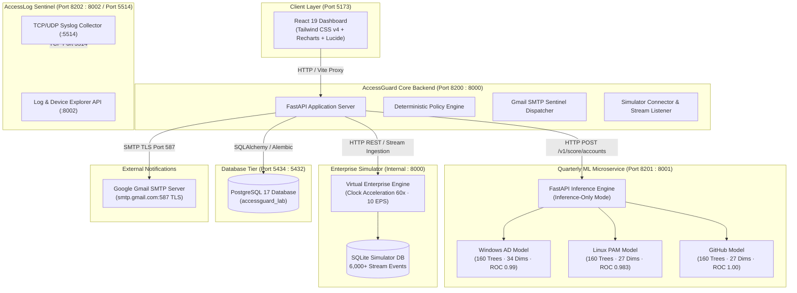

# 🛡️ AccessGuard — Intelligent Identity & User Access Governance Lab

<p align="center">
  
  
  
  
  
  
</p>

<p align="center">
  <b>A state-of-the-art research and demonstration platform for AI-assisted Identity Governance & Administration (IGA), real-time access anomaly detection, and zero-trust privilege compliance.</b>
</p>

---

## 📑 Table of Contents

- [Overview & Vision](#-overview--vision)
- [Key Platform Innovations](#-key-platform-innovations)
- [Ecosystem Architecture](#-ecosystem-architecture)
- [Microservice Network & Port Registry](#-microservice-network--port-registry)
- [Live Presentation & Navigation Flow (11 Tabs)](#-live-presentation--navigation-flow-11-tabs)
- [Machine Learning Engine (Aegis V8/V9 IsolationForest)](#-machine-learning-engine-aegis-v8v9-isolationforest)
- [Live Stream Threat Injection & Detection](#-live-stream-threat-injection--detection)
- [Automated Sentinel Email Alerts (Gmail SMTP)](#-automated-sentinel-email-alerts-gmail-smtp)
- [Quick Start Guide (Docker Compose)](#-quick-start-guide-docker-compose)
- [Local Development Setup](#-local-development-setup)
- [Research Principles & Zero-Trust Guardrails](#-research-principles--zero-trust-guardrails)
- [Presentation & Documentation Artifacts](#-presentation--documentation-artifacts)

---

## 🌟 Overview & Vision

In enterprise IT and cloud ecosystems, **"Privilege Creep"**, orphaned service accounts, dormant high-risk entitlements, and toxic permission combinations represent the top vectors for lateral breach movement. Traditional periodic access reviews rely on cumbersome spreadsheets, leading to **reviewer fatigue** and rubber-stamping.

**AccessGuard** solves this by unifying:
1. **Multi-Tenant Enterprise Simulation**: Generates multi-cloud identities, accounts, resources, and live access activity at enterprise scale (100 to 100,000 users) safely in a non-destructive test laboratory.
2. **Dual-Engine Threat Defense**: Synthesizes **deterministic explainable policy heuristics (0–100 score)** with **unsupervised multi-platform machine learning (IsolationForest 160-tree anomaly percentiles)**.
3. **Live Streaming Telemetry & Real-Time Detection**: Continuously ingests streaming access logs, correlates multi-event brute-force sequences from external IPs, and flags anomalies in real time without waiting for periodic batches.
4. **Automated Alert Sentinel**: Instantly dispatches authenticated **Gmail SMTP breach advisories** to security administrators within seconds of detection.
5. **Strict Human-in-the-Loop Governance**: Adheres to ISO 27001 and SOC 2 Type II compliance standards by using AI for advisory prioritization while keeping final remediation authorization strictly in human hands.

---

## ⚡ Key Platform Innovations

| Feature | Description | Benefit |
|---|---|---|
| **Dual-Engine Defense** | Merges 0–100 deterministic rule scores with 160-tree IsolationForest anomaly percentiles. | 100% transparent and explainable risk scores without "black-box" decisions. |
| **Aegis V8/V9 Platform Models** | Dedicated independent ML models for **Windows AD (34 dims)**, **Linux PAM (27 dims)**, and **GitHub (27 dims)**. | High discriminative accuracy (**99.1% average ROC-AUC**, **100% precision @ 5% threshold**). |
| **Live Stream Attack Blaster** | Inject realistic multi-log attack bursts (SSH brute-force, root sudo escalation, IAM console hijack) directly into the simulation stream. | Eliminates reliance on pre-canned scenarios; proves live stream detection capabilities. |
| **Real-Time Log Stream HUD** | React frontend auto-polls streaming events every 2 seconds (`● Live Stream Active`) with glowing threat HUD banners. | Immediate visual correlation between injected attack logs and system detection. |
| **Automated Gmail Sentinel** | Dispatches rich, branded HTML security alerts via authenticated Gmail SMTP (port 587 TLS). | Immediate operational awareness for SecOps engineers without alert fatigue. |
| **Non-Destructive Remediation** | Simulates entitlement revocation locally within the database and updates an immutable audit trail. | Completely safe for demonstration and academic evaluation without breaking production credentials. |

---

## 🏗️ Ecosystem Architecture

AccessGuard is engineered as a distributed, decoupled multi-service suite orchestrated via Docker Compose:



---

## 🔌 Microservice Network & Port Registry

All services are bound cleanly to Docker's internal bridge network (`accessguard-net`) with dedicated host port mappings:

| Container Name | Internal Port | Host Port | Protocol | Purpose |
|---|---|---|---|---|
| **`accessguard-frontend`** | `80` | `5173` | HTTP | Production Nginx web server serving React 19 UI |
| **`accessguard-backend`** | `8000` | `8200` | HTTP | Core FastAPI identity governance and risk API |
| **`accessguard-ml-service`** | `8001` | `8201` | HTTP | Aegis V8/V9 IsolationForest multi-platform ML engine |
| **`accessguard-enterprise-simulator`** | `8000` | Internal | HTTP | Synthetic multi-tenant enterprise simulation engine |
| **`accessguard-accesslog-service`** | `8002` / `5514` | `8202` / `5514` | HTTP / TCP | Standalone syslog daemon & log exploration service |
| **`accessguard-complete-postgres`** | `5432` | `5434` | TCP / PG | PostgreSQL 17 relational database |

---

## 🧭 Live Presentation & Navigation Flow (11 Tabs)

The Test Environment sidebar is organized to mirror a flawless 5-minute live demonstration flow:

```text
1. 🏢 Virtual Companies     ➔ Multi-tenant enterprise simulation models & presets
2. 👥 Virtual Employees     ➔ Canonical identity directory & organizational units
3. 📊 Test Overview         ➔ Executive dashboard (100 Identities, 219 Accounts, 657 Grants)
4. ⚡ Simulation Controls   ➔ Traffic loop speed (60x), EPS, and Live Threat Stream Generator
5. 📈 Generated Activity    ➔ Real-time access log stream auto-polling every 2 seconds
6. 🎯 Test Scenarios        ➔ Pre-packaged automated attack & privilege creep templates
7. 📋 Simulated Reviews     ➔ Human-in-the-Loop access certification queue
8. 🛡️ AI & ML Risk Engine   ➔ Dual-engine comparative breakdown (Rule Score vs ML Percentile)
9. 🏆 ML Model Center       ➔ Aegis V8 models, ROC-AUC metrics & Interactive Inference Sandbox
10. 📜 Audit Trail          ➔ Cryptographically verified immutable compliance history
11. ✉️ Admin Email Alerts   ➔ Real-time Gmail SMTP alert settings and delivery logs
```

---

## 🧠 Machine Learning Engine (Aegis V8/V9 IsolationForest)

AccessGuard's ML microservice operates in **strict `inference_only` mode**, utilizing hash-verified Scikit-Learn `IsolationForest` pipeline artifacts. Models are trained on verified 90-day normalized behavioral windows.

### Platform Validation Benchmarks

| Platform Model | Artifact | Tree Estimators | Behavioral Dimensions | ROC-AUC | Average Precision (PR-AUC) | Precision @ 5% Outliers | Recall @ 20% Outliers |
|---|---|---|---|---|---|---|---|
| **Windows Active Directory** | `windows.joblib` | 160 Trees | **34 Dimensions** | **0.9900 (99.0%)** | **0.9379 (93.8%)** | **100.0%** | **100.0%** |
| **Linux PAM & Sudoers** | `linux.joblib` | 160 Trees | **27 Dimensions** | **0.9834 (98.3%)** | **0.8955 (89.6%)** | **100.0%** | **100.0%** |
| **GitHub Enterprise** | `github.joblib` | 160 Trees | **27 Dimensions** | **1.0000 (100%)** | **1.0000 (100%)** | **100.0%** | **100.0%** |

### Key Behavioral Feature Dimensions

- **Windows AD:** `windows_privileged_logon_events`, `out_of_scope_ad_group_count`, `ad_department_mismatch`, `privileged_entitlements`, `log_coverage_days`, `resource_uses_month_3`, `distinct_resources_used_window`, `active_days_window`.
- **Linux PAM:** `linux_sudo_events`, `linux_sudo_coverage_known`, `privileged_ad_group_count`, `privileged_entitlements`, `failed_logins_window`, `active_days_window`.
- **GitHub:** `github_repo_activity_events`, `unmapped_ad_group_count`, `permission_changes_window`, `resource_use_events_window`.

### Interactive Live Inference Sandbox

In the **ML Model Center**, examiners can adjust sliders (Privileged Entitlements, Failed Logins, Off-hours Events, Department Mismatch) and click **"⚡ Execute Live Model Inference"**. The active 160-tree model scores the multidimensional vector in **~14 milliseconds**, outputting an anomaly percentile (e.g., `99.9%`), risk classification, and automated escalation advice.

---

## 🚨 Live Stream Threat Injection & Detection

AccessGuard enables live threat demonstration without canned scripts:

1. Navigate to **Simulation Controls** or **Generated Activity**.
2. Select a threat pattern:
   - `🚨 Brute-Force Auth & Root Sudo Escalation` (Linux PAM)
   - `🚨 AWS IAM Console Hijack & Role Escalation` (AWS Cloud)
   - `🚨 Bulk Repository & Secret Exfiltration` (GitHub Enterprise)
   - `🚨 Active Directory Privilege Creep` (Windows AD)
3. Adjust the burst count slider (e.g., 8 logs) and click **"⚡ Blast Malicious Logs into Live Simulation Stream"**.
4. **What Happens Automatically in Real Time:**
   - 7 failed logins + 1 privileged breach from external IP `185.220.101.4` are injected into the active simulator stream.
   - AccessGuard's log listener correlates the sequence.
   - Deterministic policy score jumps to **100 (Critical Risk)**.
   - IsolationForest calculates an anomaly percentile of **99.4%**.
   - A glowing red **Real-Time Threat HUD Banner** appears on screen.
   - The logs appear in the **Generated Activity** table highlighted in red with a `🚨 THREAT` badge.
   - A governance review ticket is queued in **Simulated Reviews**.
   - An authenticated **Gmail Security Alert** is dispatched to the administrator within 2 seconds.

---

## 📧 Automated Sentinel Email Alerts (Gmail SMTP)

AccessGuard integrates a production-ready email notification engine utilizing standard Gmail SMTP credentials:

- **SMTP Host:** `smtp.gmail.com`
- **Port:** `587` (STARTTLS) or `465` (SSL)
- **Authentication:** Standard 16-character Google App Password (2-Step Verification).
- **Trigger Conditions:**
  - High-Risk Privilege Escalation (Score ≥ 60).
  - Malicious Role Breach / Live Stream Attack Detected.
  - Quarterly Access Reviews Queued.

The dispatched emails feature a responsive HTML template containing the target identity, department, platform, dynamic risk score (e.g., `100 / 100`), detection rule, and timestamped evidence.

---

## 🚀 Quick Start Guide (Docker Compose)

The entire multi-container ecosystem can be spun up in a single command.

### Prerequisites

- **Docker Desktop** (with Linux container support enabled).
- **Git**.

### Launch Steps

```bash
# 1. Clone the repository
git clone https://github.com/your-org/AccessGuard.git
cd AccessGuard

# 2. Build and start all 6 containers
docker compose up -d --build

# 3. Verify running containers
docker compose ps
```

### Access Points

- **AccessGuard Web UI:** [http://127.0.0.1:5173](http://127.0.0.1:5173)
- **Backend API & Swagger Docs:** [http://127.0.0.1:8200/docs](http://127.0.0.1:8200/docs)
- **ML Microservice Status:** [http://127.0.0.1:8201/v1/models](http://127.0.0.1:8201/v1/models)
- **AccessLog Collector API:** [http://127.0.0.1:8202/docs](http://127.0.0.1:8202/docs)

---

## 🛠️ Local Development Setup

If you wish to run backend and frontend natively for development:

### 1. Database
```bash
docker compose up -d postgres ml-service enterprise-simulator
```

### 2. Backend (FastAPI)
```bash
cd backend
python -m venv .venv
# On Windows: .\.venv\Scripts\Activate.ps1 | On Linux/macOS: source .venv/bin/activate
pip install -r requirements.txt
python -m alembic upgrade head
python seed_demo.py
python -m uvicorn main:app --reload --host 127.0.0.1 --port 8000
```

### 3. Frontend (React 19)
```bash
cd frontend
npm install
npm run dev
# Accessible at http://127.0.0.1:5173
```

---

## ⚖️ Research Principles & Zero-Trust Guardrails

AccessGuard was designed following strict ethical research and identity governance principles:

1. **Advisory AI, Not Autonomous Execution**: Machine learning anomaly scores provide prioritization percentiles. The system **never executes autonomous privilege revocations** without human authorization.
2. **Absence of Evidence is Not Evidence of Absence**: Missing log telemetry is transparently tagged as *unverified activity* rather than conclusively labeled as safe or abandoned access.
3. **Non-Destructive Simulated Remediation**: Revocations update local relational states, write immutable audit records, and notify administrators without executing destructive remote commands on third-party APIs.
4. **Synthetic Data Hygiene**: All employee names, corporate emails, and IP origins are generated synthetically using seeded pseudorandom algorithms.

---

## 📚 Presentation & Documentation Artifacts

For presenters, examiners, and evaluators, comprehensive documentation is provided in the repository:

- 📖 **[5-Minute Live Viva Demo Script](VIVA_LIVE_DEMO_SCRIPT.md)** — Step-by-step click order and spoken English cues for viva presentations.
- 🗣️ **[Page-by-Page Presentation Guide](PAGE_BY_PAGE_PRESENTATION_GUIDE.md)** — Detailed English speaking script for all 11 tabs in the sidebar.
- 📝 **[Master Presentation Script (English)](MASTER_PRESENTATION_SCRIPT_EN.md)** — Comprehensive 10-page academic presentation paper.
- 🇱🇰 **[Master Presentation Script (Sinhala / සිංහල)](MASTER_PRESENTATION_SCRIPT.md)** — Complete 10-page presentation guide in Sinhala.
- 🎨 **[Animated Slides Generation Prompt](ANIMATED_SLIDES_PROMPT.md)** — Ready-to-use prompt for generating interactive HTML presentation decks.
- 🔬 **[Research Methodology & Metrics](docs/RESEARCH_METHODOLOGY.md)** — In-depth mathematical formulas for risk weights, isolation trees, and evaluation ROC curves.

---

<p align="center">
  <b>AccessGuard Research Suite · Intelligent Access Governance & Anomaly Detection</b><br/>
  Developed for Enterprise Security Research · Powered by FastAPI, React 19, Scikit-Learn & PostgreSQL
</p>
